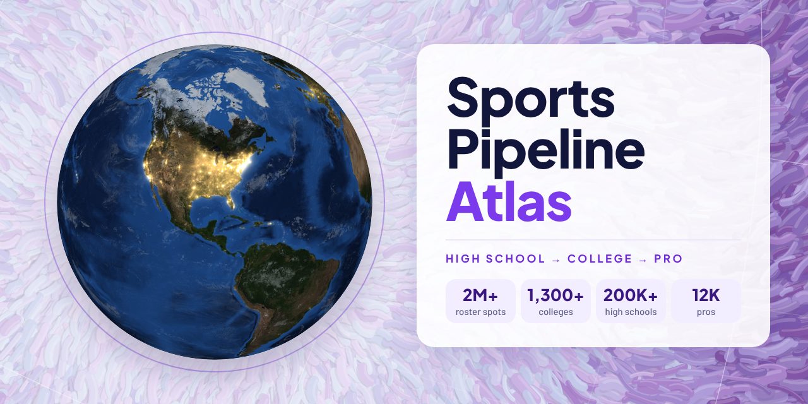

# Sports Pipeline Atlas



Where athletes come from, from high school to college to the pros, and where players and coaches move, sport by
sport. Rosters and staff lists are scraped from each school's athletics site every season since 2016, hometowns are
placed on a map, and everything is published as a static site in `docs/` (GitHub Pages).

**Live site:** https://sarahmlammert.github.io/sports-pipeline-atlas/

Called the College Sports Atlas until Nov 22, 2026 (the repository was `college-sports-atlas`; GitHub forwards the old
repository address, but not the old site address).

## What's in it

About 2.4 million roster spots from 1,384 colleges and 200,000 high schools, in 30 sports, plus 12,000 NFL, NBA,
MLB and NHL players traced back to their college rosters.

| sport | folder | schools | players | seasons |
|---|---|---|---|---|
| Football | `football` | 831 (FBS, FCS, D2, D3, NAIA, JUCO) | 445K | 2016–2019, 2021–2026 (no 2020) |
| Baseball | `baseball` | 1,083 (D1, D2, D3, NAIA, JUCO) | 218K | 2016–2027 |
| Softball | `softball` | 1,118 (D1, D2, D3, NAIA, JUCO) | 115K | 2016–2027 |
| Lacrosse (Men's) | `lacrosse-mens` | 430 (D1, D2, D3, NAIA, JUCO) | 69K | 2016–2027 |
| Lacrosse (Women's) | `lacrosse-womens` | 583 (D1, D2, D3, NAIA, JUCO) | 58K | 2016–2027 |
| Hockey (Men's) | `hockey-mens` | 162 (NCAA D1, D2, D3) | 20K | 2016–2027 |
| Hockey (Women's) | `hockey-womens` | 127 (National Collegiate = D1 and D2 schools, D3) | 12K | 2016–2027 |
| Basketball (Men's) | `basketball-mens` | 1,219 (D1, D2, D3, NAIA, JUCO) | 121K | 2016–2027 |
| Basketball (Women's) | `basketball-womens` | 1,221 | 99K | 2016–2027 |
| Volleyball (Women's) | `volleyball-womens` | 1,192 | 98K | 2016–2026 (fall) |
| Volleyball (Men's) | `volleyball-mens` | 260 | 16K | 2016–2027 |
| Soccer (Men's) | `soccer-mens` | 949 | 152K | 2016–2026 (fall) |
| Soccer (Women's) | `soccer-womens` | 1,161 | 148K | 2016–2026 (fall) |
| Wrestling (Men's) | `wrestling-mens` | 315 | 44K | 2016–2027 |
| Wrestling (Women's) | `wrestling-womens` | 175 | 9K | 2016–2027 |
| Field Hockey | `field-hockey` | 276 (NCAA) | 26K | 2016–2026 (fall) |
| Water Polo (Men's) | `water-polo-mens` | 50 (NCAA) | 5K | 2016–2026 (fall) |
| Water Polo (Women's) | `water-polo-womens` | 59 (NCAA) | 5K | 2016–2026 |
| Rowing (Men's) | `rowing-mens` | 54 (NCAA) | 9K | 2016–2026 |
| Rowing (Women's) | `rowing-womens` | 136 (NCAA) | 25K | 2016–2026 |
| Tennis (Men's) | `tennis-mens` | 735 | 35K | 2016–2026 |
| Tennis (Women's) | `tennis-womens` | 880 | 38K | 2016–2026 |
| Golf (Men's) | `golf-mens` | 939 | 43K | 2016–2026 |
| Golf (Women's) | `golf-womens` | 844 | 27K | 2016–2026 |
| Cross Country (Men's) | `cross-country-mens` | 1,137 | 75K | 2016–2026 (fall) |
| Cross Country (Women's) | `cross-country-womens` | 1,186 | 75K | 2016–2026 (fall) |
| Track & Field (Men's) | `track-mens` | 956 (indoor and outdoor together) | 148K | 2016–2026 |
| Track & Field (Women's) | `track-womens` | 1,035 (indoor and outdoor together) | 141K | 2016–2026 |
| Swimming & Diving (Men's) | `swimming-mens` | 471 | 43K | 2016–2027 |
| Swimming & Diving (Women's) | `swimming-womens` | 571 | 55K | 2016–2027 |

Schools are the ones with players in the data. A sport that is set up but not built yet shows as "coming soon" on
the front page.

**Season names.** Football, volleyball and soccer are named by the fall they're played in. Spring and winter sports
are named by the spring the season ends in (2025-26 = 2026); from August the current season is next spring's. The
pages show school years (2023-24); links and data files keep the season number. Every script uses the same few
functions in `scripts/core.py` for this (`season_span`, `season_from_label`, `fill_season`, `current_season`), and
`docs/common.js` has the same rule for the site.

## The site

### Front page

`docs/index.html` is a spinning globe with one ring of discs around it.

- **Maps** picker (top right): high school, college or pro. College puts the season's sports on the ring (each sport's
  `ring` in its settings); pro puts the NFL, NBA, MLB and NHL there, each opening the Pro Pipeline; high school maps
  are still to come.
- **Season** picker (top left, college maps): fall, winter or spring; it opens on the season being played.
- The address keeps the choice (`#season=winter`, `#level=pro`).
- The globe is NASA's Blue Marble (`docs/img/earth.jpg`, from the three-globe package's example images); if it can't be
  read, world-atlas's 1:50m map is drawn instead. The ring's layout is a fixed stage (`W`, `H`, `SHOWN` for the globe,
  `ORBIT`, `DISC`, `MINI_R` in index.html) scaled to fit the window.
- Behind it, oil-paint brushstrokes in the season's colors (`PAINT` in index.html; violets for pro and high school),
  muted so they don't glare (`MUTE`), under a faint latitude-longitude grid.
- The globe holds Search by high school and, except on the high school maps, a Pro Pipeline button.
- Clicking a sport lists its maps; **Search by high school** looks through `docs/high_schools.json` (then
  `high_schools_more.json`, the one-player schools) and links to that
  school on each sport's Recruiting Map.

### Map pages

One set of pages serves every sport, with the sport in the address (`players-dotmap.html?sport=softball`):

- **Recruiting Map** (`players-dotmap.html`): a dot for every hometown, worldwide; filters for school, conference,
  division, seasons, transfers and positions; search for a school, player or town. Night lights (the moon button, on
  by default) darken the map and make each hometown glow in its school's color.
- **Recruiting Footprints** (`players-heatmap.html`): up to four schools compared, state by state.
- **Transfer Map** (`players-transfers.html`): school-to-school moves.
- **Coaching Moves** (`staff-moves.html`): coaches moving between schools.
- **Staff Directory** (`staff-directory.html`): a school's staff by season, its head coaches over time, and any
  person's career.
- **School Influence Map** (`school-influence.html`): where everyone who had been at a school was in a given season,
  and how the school ranks. Built in the browser from the player and staff data.
- **Pro Pipeline** (`pro-pipeline.html`, one page for every league): NFL, NBA, MLB and NHL players since 2016 traced
  back to their college and high school, with league and team pickers, a season range, a search, and one player's
  path (hometown → college → teams). Teams are drawn in their official colors (`config/shared/pro_teams.csv`); the
  data is `docs/pro/pipeline.json`.

**Relief and rivers.** The maps sit on NASA's Blue Marble shaded relief and bathymetry (`docs/basemap.js`), as
web-map tiles from FreeTiler (github.com/freetiler/nasa-bluemarble, MIT), recoloured in the browser like a physical
atlas. Zooms 0-6 are kept in the site (`docs/tiles/bluemarble`, 5,461 tiles, about 30 MB), because jsDelivr refuses
that repository for being over its size limit. Rivers come from `docs/rivers.json` (Natural Earth 1:10m, public
domain); smaller ones appear as the Recruiting Map zooms in. Footprints keeps its plain states, since it colours them
by numbers. If the tiles can't load, the maps keep their plain land.

**How the pages work.**

- Every page shares one strip of maps in its title bar (`MAPS` in `docs/common.js`) and a sport dropdown; both keep the
  school being shown.
- Every view is saved in the address after `#` (e.g. `players-dotmap.html?sport=football#school=Alabama&pos=QB`), so
  links can be shared.
- Football and baseball open on D1 (`map_data.json`) and load the other divisions (`map_data_more.json`) only when
  needed. Map and staff data are packed by `build.py` and `staff.py` and unpacked by `docs/common.js`.
- Each sport's own words (title, description, she/her for women's sports) and its place on the front page are in the
  `site` part of `config/<sport>/settings.json`. `python3 scripts/build.py pages` copies them into `docs/sports.js`
  (don't edit that file by hand; the pipeline's build step runs it).
- Shared styles and helpers live in `docs/common.css` and `docs/common.js`; colors are CSS variables at the top of
  `common.css` and `index.html`. Headings use Plus Jakarta Sans, text Barlow.
- `docs/sources.html` builds its list from `sports.js` and each `summary.json`.
- Icons: `docs/img/favicon.svg`, `favicon-32.png` and `apple-touch-icon.png`; a new page needs the same three
  `<link>` lines. The repository's social preview is `docs/img/social-card.png` (1280×640; set it in GitHub → Settings →
  Social preview).

**Publish:** GitHub → Settings → Pages → deploy from branch `main`, folder `/docs`. To look locally:
`cd docs && python3 -m http.server`, then http://localhost:8000.

## Running it

Setup once:

```
python3 -m venv .venv && source .venv/bin/activate
pip install -r requirements.txt
python3 -m playwright install chromium    # the browser retries and the page test
npm install                               # the site's linter (needs Node.js)
```

pandas and pyarrow in requirements.txt are only for `scripts/nba_history.py` (past NBA seasons). The scripts switch
to `.venv` by themselves when a package is missing.

```
caffeinate -i python3 scripts/pipeline.py all              # every sport, every step
python3 scripts/pipeline.py softball hockey-mens           # some sports
python3 scripts/pipeline.py baseball --steps geocode,build # some steps
python3 scripts/pipeline.py football --from geocode        # start at a step
python3 scripts/pipeline.py softball --dry-run             # print the commands only
python3 -m pytest tests -q                                 # the tests (about a minute with the page test)
python3 -m ruff check scripts tests                        # the Python linter (rules in ruff.toml)
npm run lint                                               # the site's linter, ESLint
```

Steps, in order: `test` (only with `--test`) → `scrape` (quick pass) → `retry` (slow pass with a browser) → `redo-current` (only with
`--redo-current`) → `geocode` → `fix-hometowns` → `frozen` → `build` → `locations` → `staff` → `check`.
Useful options: `--rescrape` (every school again, not just what's missing), `--only "A,B"`, `--division D1`,
`--seasons 2024-2026`, `--retry-given-up`, `--keep-going`. A sport can't be run twice at once (a lock in
`rosters/college/<sport>/`). The terminal shows one line per school; long lists go to `rosters/college/<sport>/notes_*.txt`, and the
full output to `rosters/college/<sport>/pipeline.log`.

The steps one by one:

| command | does |
|---|---|
| `scrape_rosters.py --sport X` | download and read rosters (`--problems` only rewrites `MISSING_ROSTERS.md`) |
| `geocode.py --sport X` | place hometowns (`rosters/college/<sport>/hometowns.csv`, `unmatched_hometowns.csv`) |
| `hometown_fixes.py suggest --sport X [--accept-likely]` | suggest fixes for unplaced hometowns |
| `hometown_fixes.py spellings --sport X` | fix misspelled towns from the geocoder's table |
| `hometown_fixes.py review [--apply FILE]` | list automatic spelling fixes to check by hand, then apply your decisions |
| `hometown_fixes.py check` | load the geocoder's town lists and look up a few sample towns |
| `build.py frozen / map / locations / check / pages` | class-year check, map data, campus file, roster check, site pages |
| `build.py compare --sport X --school S --season Y` | a school's roster against its season before, player by player |
| `staff.py scrape / build --sport X` | coaches from the roster pages, then the staff data |
| `core.py compress-cache` | compress the page cache |

The page test (`tests/test_pages.py`) opens every page for football, softball and women's hockey in a headless
browser and fails on any error; `PAGE_TEST_SPORTS=all` checks every sport (about 190 pages, several minutes).

## Pro rosters

`scripts/pro_rosters.py` reads each league's rosters with every player's college, then finds him on that college's
roster here (by name, by last name and fitting first names, or by name and birthplace), so his hometown and high
school come from the college data. It writes `rosters/pro/<league>_<season>.csv` and `_matched.csv`; `--build` turns
every matched file into the Pro Pipeline's data. Seasons are named by the year they start (NBA and NHL 2026 =
2026-27; MLB's 2027 is this winter's 40-man rosters).

| league | this season | past seasons |
|---|---|---|
| NFL | nfl.com team pages | nflverse's roster files (GitHub) |
| NBA | nba.com team pages | `scripts/nba_history.py`: hoopR's open ESPN data (GitHub) |
| MLB | MLB's stats API, 40-man rosters with education | the stats API's full-season rosters |
| NHL | the NHL's API, plus each player's career for his NCAA seasons | the NHL's season rosters, filled out from players' careers (those files are short from 2023-24 on and empty for Arizona 2023-24) |

```
python3 scripts/pro_rosters.py all --refresh --build            # today's rosters, every league
python3 scripts/pro_rosters.py nfl --season 2016-2026 --build
python3 scripts/pro_rosters.py mlb --season 2016-2027 --build   # about 15 minutes
python3 scripts/pro_rosters.py nhl --season 2016-2026 --build   # about 30-40 minutes
python3 scripts/nba_history.py                                  # past NBA seasons -> rosters/pro/nba_<season>.csv
python3 scripts/pro_rosters.py nba --season 2016-2025 --match-only --build
python3 scripts/pro_rosters.py --build                          # only rebuild the page's data
```

`--match-only` redoes the matching from the saved roster files (after the college rosters change). Players who were
in college before 2016 have a college but no hometown. A college needs a row in `config/shared/school_locations.csv`
to get a square on the map; `--build` counts any without one. Left out: the WNBA (its site refuses automated
visitors) and MLS (its club pages give no college).

## Folders

```
config/shared/      school_colors.csv, school_locations.csv, hometown_corrections.csv (every sport),
                    pro_teams.csv (each pro team's city, place on the map and two official colors)
config/<sport>/     settings.json (roster paths, roster size, positions, divisions, seasons, site words),
                    schools.csv (every college: division, conference, site, seasons, notes),
                    optional: hometown_corrections.csv, wrong_seasons.csv, season_pages.csv
rosters/college/    one folder per sport, not committed: rosters_<season>.csv, scrape reports, MISSING_ROSTERS.md,
                    attempts.csv, hometowns.csv, staff_<season>.csv, notes, logs and rosters.db
rosters/pro/        the pro rosters, not committed
docs/               the site: index.html, the six map pages, pro-pipeline.html, sources.html, common.js,
                    common.css, basemap.js, tiles/bluemarble/, rivers.json, img/ (globe, icons, social card),
                    pro/pipeline.json, sports.js; docs/<sport>/ has each sport's data files
scripts/            core.py (paths, downloads, seasons, levels, sub-commands), sidearm.py (reading roster pages),
                    hometowns.py (reading hometown, class, height and weight fields), scrape_rosters.py,
                    scrape_reports.py, geocode.py, hometown_fixes.py, build.py, staff.py, pipeline.py,
                    new_sports.py, pro_rosters.py, nba_history.py
tests/              test_atlas.py (the code, the parsers, the builds), test_pages.py (the site in a browser),
                    fixtures/ (nine real roster pages in roster_pages.zip with what the parser should read, and
                    two small hand-made pages)
.cache/             downloaded pages (gzip) and town lists, not committed; it makes reruns fast
```

## How it works

- **Schools.** `config/<sport>/schools.csv` lists every college the sport knows. Rows with a season range record
  moves between divisions, programs that started, stopped or closed ("none"), and colleges kept only so a
  transfer's old school gets a level ("level only"). A note starting "left out" means the site is never contacted.
- **Scraping.** For each school-season it tries the usual Sidearm/WMT/Presto addresses, then a browser. A page is
  rejected if it's another sport's, shows another season, is a main page still showing last season, or has an
  abnormal number of players. A school-season that fails 3 runs in a row is given up (`attempts.csv`;
  `--retry-given-up` tries again). Each season has its own time limit (1 minute in the quick pass, 3 in the retry).
  Pages are cached; 404s are remembered for 60 days.
- **Seasons a team doesn't have.** Seasons are scraped newest first. Once a team's page lists its seasons, older ones
  are recorded as no team and not tried; seasons older than three in a row with no roster are skipped too.
- **Men and women on one page.** Many track, cross country and swimming sites list both teams together. With
  `roster_sex` in the settings, `sidearm.keep_own_sex` keeps this team's athletes using the page's own marks; a
  combined page with no such marks is refused rather than guessed at.
- **Stand-in pages.** Some Sidearm sites show a "General Roster" page for a season a sport has no roster; the scraper
  refuses it (`sidearm.stand_in_page`).
- **Fixing a school.** See `rosters/college/<sport>/MISSING_ROSTERS.md`. Set `domain` or `roster_url` in `schools.csv`; list
  a season whose page is really another year in `wrong_seasons.csv`, or give the right page in `season_pages.csv`.
- **Jersey numbers.** Tidied by `sidearm.clean_jersey` and shown in player lists and careers.
- **Hometowns.** Read from the roster text (US states, Canadian provinces, countries, hockey's three-letter codes),
  then placed with Census, USGS and GeoNames town lists. Fixes go in `config/shared/hometown_corrections.csv`; rows
  marked `manual` in `hometowns.csv` are never changed.
- **Transfers.** A player counts as a transfer if the roster names a college as his previous school, he was on another
  school's roster here first, or he arrives as a junior or older. Junior hockey teams are never colleges. Old schools
  get a level (D1, D2, D3, NAIA, JUCO, club, unknown).
- **The roster database.** `rosters/college/<sport>/rosters.db` (SQLite) holds the season files, scrape reports and hometown
  tables, rebuilt from the CSVs whenever one changes, so the CSVs stay the files to edit.
- **Staff.** Coaches are read from the roster pages (or the coaches page) and matched by name; a move is a person's
  last season at one school followed by their first at another within two seasons.

## Adding a sport

1. Make `config/<sport>/` (sport, then sex if both, e.g. `basketball-womens`) with `settings.json` (copy one and
   change the roster paths, roster size, positions, divisions and its `site` part; `core.Sport.site` explains each
   key) and `schools.csv`. `scripts/new_sports.py` writes both from the NCAA directory. A new disc also needs an icon
   in `SPORT_ICONS` in `docs/index.html`.
2. Add any new schools' colors and campuses to `config/shared/`.
3. Run `python3 scripts/build.py pages` (the sport appears as coming soon), then `python3 scripts/pipeline.py <sport>`.
   Its build step writes `docs/sports.js`, so the sport goes live with nothing typed into `docs/`.

## Known issues

- Junior colleges with no known roster site are listed but not scraped; NJCAA's own stats pages could fill them.
- Coaches are matched by name only, so two people with the same name can be mixed up.
